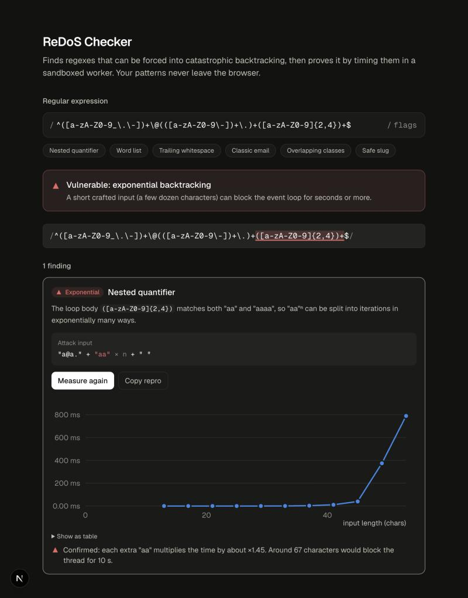

# redos-lens

**Live app: https://redos-lens.vercel.app/**

Finds regular expressions that can be forced into catastrophic backtracking (ReDoS), then proves it by timing them in a sandboxed Web Worker. Everything runs in the browser, so your patterns never leave your machine.



## What it does

- **Static analysis on every keystroke.** It flags nested quantifiers like `(a+)+`, overlapping alternation like `(\d|\w)+`, and overlapping adjacent loops like `\d+\d+` or an unanchored `\s+$`.
- **Shows how to attack it.** Each finding comes with an attack recipe (`prefix + pump × n + suffix`), a copyable repro snippet, and the vulnerable part of the pattern highlighted.
- **Only reports what can actually happen.** A finding counts only if the input reaches the loop and something forces the overall match to fail. `(a+)+` is ambiguous but harmless; `(a+)+$` is not.
- **Proves it by timing.** The regex runs against growing inputs in a disposable worker with a 3 s kill switch, so a catastrophic pattern can't freeze the tab. The measured growth is then fitted, e.g. *"×2.01 per extra char"* or *"O(n^2.0)"*.
- **Separates "confirmed" from "not reproduced".** If a static finding doesn't slow down in this browser, the result says so and tells you to test in the engine you deploy on.

## Run it

```bash
npm install
npm run dev
```

Then open http://localhost:3000. Run the tests with `npm test`.

## How it works

The short version: the analyzer parses the regex with [`@eslint-community/regexpp`](https://github.com/eslint-community/regexpp). For each loop it searches for a short "pump" string the loop can consume in more than one way, checking candidates against the real JS engine on very short inputs, where nothing can blow up. The main thread never runs a suspicious regex.

The full write-up (data flow, worker protocol, detection rules, trade-offs and limitations) is in **[docs/ARCHITECTURE.md](docs/ARCHITECTURE.md)**.

## Limitations

- Results describe backtracking engines. RE2 and Rust's `regex` are immune by design.
- Loops containing backreferences are skipped, and lookarounds are only approximated.
- The pump search is a sample rather than a proof, so "no ReDoS pattern found" doesn't guarantee a regex is safe.

## Stack

Next.js 16 (App Router, Turbopack), React 19, TypeScript, Tailwind CSS 4.
